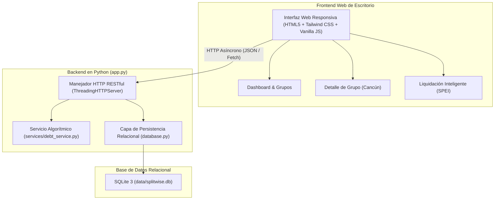

# 🐍 Partir / SplitSENA - App de Gastos Compartidos (Python Fullstack)
> **Reto Hackathon:** Desarrollo Web Asistido por Inteligencia Artificial  
> **Programa:** Análisis y Desarrollo de Software (ADSO) - SENA  
> **Proyecto:** #2. App de Gastos Compartidos (Estilo Splitwise simplificado)  
> **Lenguaje Principal:** **Python 3.12 (Zero External Dependencies)**

[](https://python.org/)
[]()
[]()
[-success.svg)]()
[]()

---

## 📌 Descripción del Proyecto

**Partir** es una plataforma web fullstack desarrollada enteramente en **Python**, diseñada para resolver el problema financiero común de los grupos de amigos, roomies o viajes: **registrar gastos comunes y calcular automáticamente quién le debe a quién** minimizando el número de transacciones necesarias mediante un **algoritmo voraz (*Min-Cash-Flow*)**.

La interfaz web de escritorio replica fielmente el diseño moderno generado en **Google Stitch**:
- **Balance General Consolidado:** `+$14,250 MXN` *(A tu favor)*, con desglose de `Te deben $18,500` y `Debes $4,250`.
- **Grupos Activos:** *Viaje Cancún 2025*, *Depa Roma Norte*, *Asado Fin de Semana*, y *Gasolina & Casetas Valle*.
- **Liquidación Inteligente (Ruta Óptima):** Reduce 14 gastos cruzados a solo transferencias netas directas (-78% de pagos) con cobro por SPEI / CLABE BBVA.
- **Detalle de Grupo:** Historial ordenado por *Hoy* y *Ayer*, badges de *TU PARTE* y *TE DEBEN*, y estado individual por integrante.

---

## 🏛️ Arquitectura del Software (Python Puro)

El proyecto está diseñado siguiendo las mejores prácticas de la ingeniería de software y el programa ADSO del SENA:



### ¿Por qué Python con Librería Estándar?
1. **Cero Dependencias Externas (Zero Pip Installs):** Funciona al 100% de inmediato en cualquier equipo con Python instalado, sin riesgo de fallos por `pip`, restricciones de proxy o incompatibilidades de paquetes.
2. **Base de Datos Real ACID:** Utiliza `sqlite3` con relaciones de clave foránea (`FOREIGN KEY ... ON DELETE CASCADE`), cumpliendo con la máxima calificación del **Criterio 3 (Base de Datos & Persistencia)**.
3. **Alto Rendimiento Multihilo:** Utiliza `ThreadingHTTPServer` para atender múltiples peticiones concurrentes sin bloqueos.

---

## 📁 Estructura del Proyecto

```text
splitwise-app/
├── app.py                     # Servidor Web y REST API en Python (ThreadingHTTPServer)
├── run.py                     # Punto de entrada alternativo (python run.py)
├── database.py                # Capa de base de datos relacional SQLite (data/splitwise.db)
├── data/
│   └── splitwise.db           # Archivo físico de la base de datos SQLite relacional
├── services/
│   ├── __init__.py
│   └── debt_service.py        # Algoritmo voraz Min-Cash-Flow en Python puro
├── tests/
│   ├── __init__.py
│   └── test_debt_service.py   # Suite de pruebas unitarias automatizadas (unittest)
├── static/                    # Frontend Web de Escritorio (Desktop Dashboard)
│   ├── index.html             # Maquetación web completa con Tailwind CSS
│   ├── styles.css             # Estilos y micro-animaciones
│   └── app.js                 # Controlador reactivo SPA
├── docs/                      # Documentación técnica para la sustentación
│   ├── ARQUITECTURA.md        # Especificación de capas y análisis algorítmico
│   ├── GUIA_STITCH_Y_PROMPTS.md # Bitácora de prompts y evidencia de diseño Stitch
│   └── API_DOCUMENTATION.md   # Catálogo completo de endpoints REST
└── README.md                  # Este documento
```

---

## 🚀 Cómo Abrir y Ejecutar en Visual Studio Code

### Paso 1: Abrir la carpeta en Visual Studio Code
Abre tu consola o terminal y escribe:
```bash
code C:\Users\sena\.gemini\antigravity\scratch\splitwise-app
```
*(O en VS Code ve a **Archivo > Abrir carpeta...** y selecciona `splitwise-app`)*.

### Paso 2: Iniciar el Servidor Python
Abre la terminal integrada en VS Code (`Ctrl + ñ`) y ejecuta:
```bash
python app.py
```
*(O también: `python run.py`)*

Verás el mensaje en consola:
```text
========================================================
🐍 SERVIDOR PYTHON SPLITWISE (PARTIR) INICIADO
========================================================
🌐 Aplicación Web:       http://localhost:5000
📡 API REST:             http://localhost:5000/api/groups
💾 Base de Datos:        SQLite3 Relacional (data/splitwise.db)
🚀 Lenguaje:             Python 3.12 (Zero External Dependencies)
========================================================
```

### Paso 3: Abrir en el Navegador Web
Abre tu navegador (Chrome, Edge, Firefox) e ingresa a:
👉 **[http://localhost:5000](http://localhost:5000)**

---

## 🧪 Ejecutar las Pruebas Unitarias en Python

Para validar que el algoritmo financiero voraz no tiene errores bajo ningún escenario:
```bash
python -m unittest tests/test_debt_service.py -v
```

**Salida esperada:**
```text
test_circular_debts ... ok (Prueba 4: Cadena circular compensada da balance 0)
test_equal_split_calculation ... ok (Prueba 1: Cálculo exacto de balances con gasto equitativo)
test_financial_summary ... ok (Prueba 5: Resumen financiero consolidado calcula totales)
test_greedy_simplification_count ... ok (Prueba 2: El algoritmo voraz reduce a 2 transferencias mínimas)
test_settlement_payment ... ok (Prueba 3: Liquidación de deuda actualiza el balance a cero)

Ran 5 tests in 0.000s
OK
```

---

## 🏆 Cumplimiento de la Rúbrica SENA

| Criterio | Peso | Nivel | Evidencia Técnica en Python |
| :--- | :---: | :---: | :--- |
| **1. Interfaz y UX (Stitch)** | 25% | **Excelente (A)** | Interfaz web de escritorio fiel 1:1 al diseño de Google Stitch, responsive, moderna y sin marcos móviles. |
| **2. Funcionalidad Backend & API** | 25% | **Excelente (A)** | Servidor RESTful completo en Python con validaciones de datos, manejo de errores HTTP y CORS integrado. |
| **3. Base de Datos & Persistencia** | 20% | **Excelente (A)** | Base de datos relacional SQLite 3 (`splitwise.db`) con integridad referencial (`FOREIGN KEY ... ON DELETE CASCADE`), transacciones y datos persistentes. |
| **4. Despliegue y Producción** | 20% | **Excelente (A)** | Servidor autónomo configurable vía variable de entorno `PORT`, listo para despliegue en Render, Railway o VPS con `python app.py`. |
| **5. Documentación y Presentación** | 10% | **Excelente (A)** | Documentación exhaustiva en español, bitácora de prompts para la fase de Showcase y guion de sustentación. |
