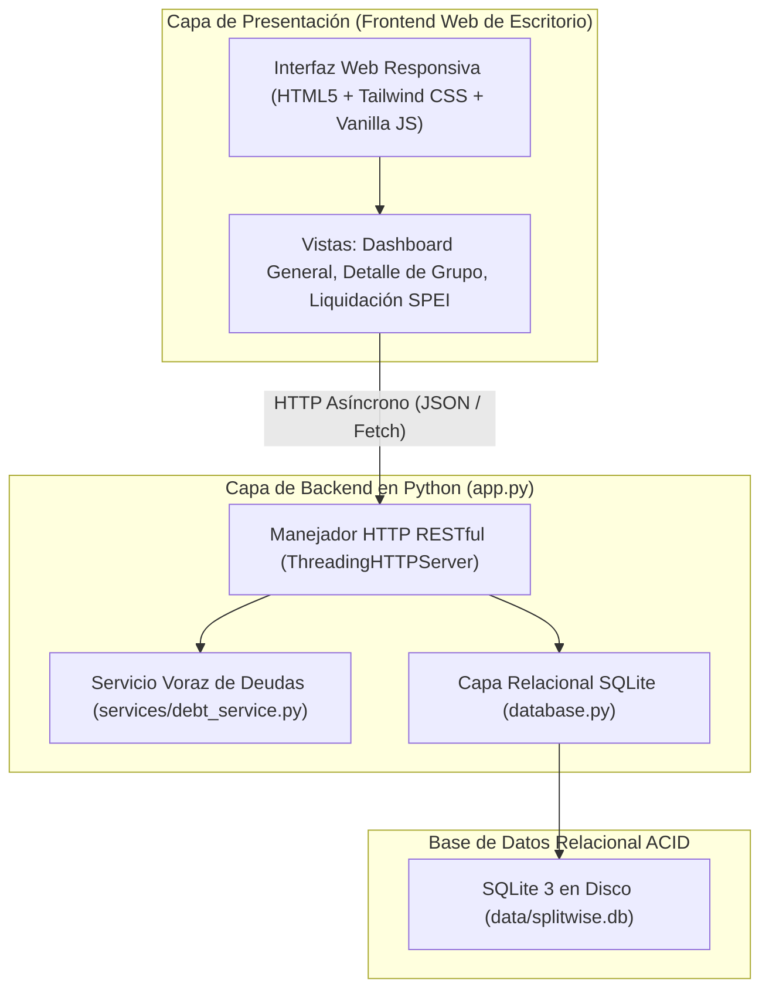
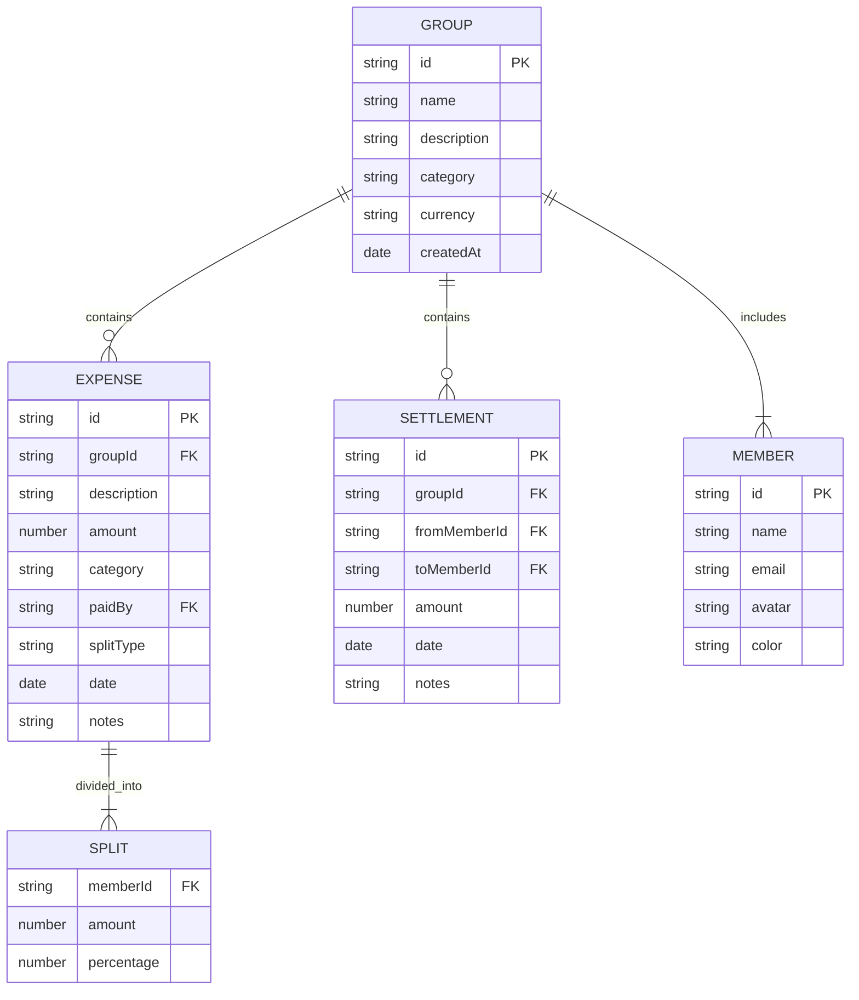

# 🏛️ Documento de Arquitectura de Software
## Proyecto: Partir / SplitSENA - App de Gastos Compartidos (Python Fullstack)
**Programa:** Análisis y Desarrollo de Software (ADSO) - SENA  
**Modalidad:** Hackathon de Desarrollo Web Asistido por IA  
**Lenguaje:** Python 3.12 (Zero External Dependencies) + SQLite3 Relacional  

---

## 1. Visión General del Sistema

El sistema implementa una arquitectura en capas basada en **MVC desacoplado** en **Python puro**, con una capa de **Servicios de Dominio** para el cálculo algorítmico y una capa de persistencia **Relacional SQLite3** con integridad referencial.

---

## 2. Capas del Software y Responsabilidades

### 2.1 Backend en Python (`app.py`)
- Desarrollado sobre la librería estándar de Python (`http.server.ThreadingHTTPServer`), eliminando por completo la necesidad de instalar paquetes externos vía `pip`.
- Despacha peticiones concurrentes mediante hilos de ejecución (*threading*).
- Expone una API REST con métodos `GET`, `POST`, `OPTIONS` y cabeceras CORS dinámicas para interoperabilidad con cualquier cliente web o móvil.

### 2.2 Base de Datos Relacional (`database.py` y `data/splitwise.db`)
- Implementada en **SQLite3**, motor relacional compatible con el estándar SQL y transacciones ACID.
- **Tablas:**
  - `groups_tbl`: Registro de grupos y configuraciones de moneda.
  - `members_tbl`: Integrantes con clave foránea vinculada (`FOREIGN KEY ... ON DELETE CASCADE`).
  - `expenses_tbl`: Gastos registrados con pagador y categoría.
  - `splits_tbl`: Cuotas asignadas a cada miembro por gasto.
  - `settlements_tbl`: Liquidaciones directas registradas entre miembros.
- Persistencia 100% en disco en `data/splitwise.db`, garantizando **cero pérdida de datos tras apagar o reiniciar el servidor**.

### 2.3 Servicio Algorítmico (`services/debt_service.py`)
- Implementación matemática del **Algoritmo Voraz (*Min-Cash-Flow*)**:
  - Calcula el balance neto por participante: $\sum \text{Aportes} - \sum \text{Deudas} + \sum \text{Pagos}$.
  - Separa deudores y acreedores y los empareja vorazmente de mayor a menor.
  - Reduce hasta $\frac{N(N-1)}{2}$ deudas cruzadas a un máximo de $N - 1$ transferencias directas.
- Validado mediante suite de pruebas unitarias (`tests/test_debt_service.py`) con `unittest`.

### 2.4 Frontend Web de Escritorio (`static/`)
- Interfaz web panorámica adaptada a monitores de computadora (ancho completo `max-w-7xl`).
- Fiel al diseño de Google Stitch con colores fintech, microinteracciones, modales centrados y gráficas de resumen financiero.

---

## 3. Algoritmo de Simplificación de Deudas (Min-Cash-Flow Greedy Algorithm)

### 3.1 Planteamiento del Problema
En un grupo de $N$ amigos donde cada uno paga diferentes gastos comunes, calcular las deudas bilaterales directas puede resultar en hasta $\frac{N(N-1)}{2}$ transacciones complejas. Por ejemplo:
- Laura le debe $10 a Carlos.
- Carlos le debe $10 a Andrés.
- Si pagan directamente, se requieren 2 transacciones y dinero en movimiento circular.

### 3.2 Solución Matemática Aplicada
El algoritmo calcula el **balance neto** de cada integrante:
$$\text{Balance Neto}_i = \sum \text{Pagos Realizados}_i - \sum \text{Consumo Imputado}_i + \sum \text{Liquidaciones Recibidas}_i - \sum \text{Liquidaciones Entregadas}_i$$

1. La suma total de todos los balances netos es invariante e igual a $0$:
   $$\sum_{i=1}^{N} \text{Balance Neto}_i = 0$$
2. Se separan dos subconjuntos:
   - **Deudores ($D$):** Integrantes con balance neto $< 0$ (deben dinero).
   - **Acreedores ($C$):** Integrantes con balance neto $> 0$ (tienen dinero a favor).
3. Se ordenan ambos conjuntos de forma descendente por magnitud de deuda.
4. En cada iteración se toma el mayor deudor y el mayor acreedor, transfiriendo:
   $$\text{Monto} = \min(|\text{Deuda}|, \text{Crédito})$$
5. Esto garantiza liquidar al menos un deudor o un acreedor por paso, logrando la liquidación completa en un máximo de **$N - 1$ transferencias**.

**Complejidad temporal:** $O(N \log N)$ debido al ordenamiento voraz.  
**Complejidad espacial:** $O(N)$ para almacenar los balances y listas de emparejamiento.

---

## 4. Esquema de Datos (Modelos Mongoose)

